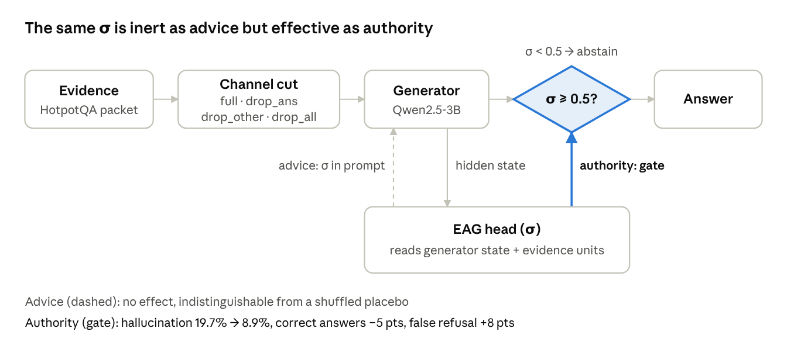

# Epistemic Access Architecture

**LLMs often *know* their evidence is insufficient. They just don't act on it unless that knowledge is given authority.**

*English · [Bahasa Indonesia](README.id.md)*

This repository studies one kind of hallucination in retrieval-augmented question answering: a model answers confidently even though the evidence it needs never reached it. I cut the evidence channel between a *reader* and a *generator* on purpose, one paragraph at a time, and measure what the generator does next. Every confirmatory study was pre-registered, including its failure criteria, and ran on a single 8 GB laptop GPU.

> **Status:** independent pilot research, not peer reviewed. Feedback and criticism are very welcome.

<p align="center">
  
</p>

## Key findings

| # | Finding | Evidence |
|---|---|---|
| 1 | **Missing evidence produces confident wrong answers.** Remove the paragraph that holds the answer and the answers models still give are mostly wrong. | Selective risk rises from 0.19–0.36 to **0.75–0.84** on Qwen2.5 1.5B, 3B and 7B |
| 2 | **Confabulations are built from leftovers, not memory.** | **74–84%** of fabricated answers are copied from the evidence that remains; only 1% match the model's closed-book answer |
| 3 | **The model already knows the evidence is insufficient.** | A 3.4M-parameter head on the frozen model's hidden states separates complete from incomplete evidence with **0.98–0.99** paired accuracy, including on a condition it never saw in training. A plain probe on the hidden state does as well |
| 4 | **That knowledge only matters when it has authority.** As a hint in the prompt it is indistinguishable from a shuffled placebo. As a binding gate it cuts hallucination from **22.6% to 9.3%**. | Pre-registered Study 3, confirmed on Qwen2.5-3B and on a second model family (Gemma 4 E4B) |

The honest cost: the gate also lowers the answer rate (35% → 18%) and raises false refusals on fully answerable questions by about 11 points. At a matched answer rate, its advantage over a *random* gate is about 2.4 points. Its real edge over standard uncertainty signals is far fewer refusals of answerable questions (see [Benchmark](#benchmark-against-standard-uncertainty-signals)).

## Motivation

The starting point was the split-brain literature. When the corpus callosum is severed, the speaking hemisphere still produces a fluent explanation for actions driven by information it never received (Gazzaniga's *left-hemisphere interpreter*). Finding 2 shows a functionally similar pattern in LLMs. I use this only as an analogy for specialisation, a narrow communication channel and narration from partial information; I make no claim that LLMs work like brains.

The general claim that "knowledge a model has ≠ knowledge it expresses" is already established (Gekhman et al., COLM 2025), so the work focuses on what can be tested causally. The data then moved the question from *access* to *authority*:

- **RQ1 (access):** does cutting the reader → generator evidence channel causally increase hallucination?
- **RQ2 (mechanism):** where does the content of a fabricated answer come from when access is blocked?
- **RQ3 (authority):** does the same sufficiency signal behave differently as advice versus as a binding decision?

## Method

Each question is tested against itself under several conditions. Across conditions, the only thing that changes is which paragraphs reach the generator.

- **Data:** HotpotQA (distractor setting), questions that need exactly two gold paragraphs. Pilot: 500 questions (311 in the primary population). Studies 2–3: 400 new questions (255 in the primary population).
- **Models:** Qwen2.5-Instruct 1.5B, 3B and 7B (7B in 4-bit), greedy decoding. Gemma 4 E4B via Ollama for cross-family replication.
- **Channel manipulation:** a gold paragraph is removed whole and replaced, in the same position, with a distractor of matched token length (length ratio 0.99–1.00).

| Condition | What reaches the generator |
|---|---|
| `full` | both gold paragraphs |
| `drop_ans` | only the bridge paragraph; the answer is not in the text |
| `drop_other` | only the answer paragraph; the reasoning chain is broken |
| `drop_all` | no gold paragraph |

**Metrics.** *Hallucination* = a substantive answer that is wrong. *Selective risk* = hallucinations ÷ substantive answers. *False refusal* = refusing although the evidence is complete. *AURC* = area under the risk–coverage curve.

**Safeguards.** Hypotheses and failure criteria written before seeing data, with every deviation logged. Paired per-question tests (exact McNemar), per-question bootstrap CIs and Holm correction. A design review before each study; three rounds caught real problems (for example, answer leakage through paragraph titles) before any data was seen. Tiered correctness labels: rules for clear cases, per-item audit of 379 ambiguous cases, and an LLM judge plus strict labels as sensitivity analyses.

### The sufficiency head (EAG)

Qwen2.5-3B stays frozen. Only a small head is trained, with ordinary supervised learning. The labels come from how each evidence packet was built, not from the model's answers.

```
evidence packet + question ──► Qwen2.5-3B (frozen, one forward pass, no generation)
                                   │
              ┌────────────────────┴─────────────────────┐
              ▼                                          ▼
   h: last-position state,                    M: one vector per evidence
   layers 18, 27, 36                          sentence, layer 22
              │                                          │
              └──► query ── cross-attention over M ──► MLP ──► σ = P(evidence sufficient)
```

- **Training data:** 6,931 HotpotQA *train* questions × 4 conditions = 27,724 packets. Label y = 1 only for `full`. All `drop_other` packets are held out to test generalisation to an unseen kind of insufficiency. Test questions come from HotpotQA *dev*, so no test question is ever trained on.
- **Loss:** BCE plus a contrastive hinge that forces σ(`full`) above σ(`drop_ans`) for the same question by a margin of 2, so the head must read the evidence rather than surface features of the question.
- **Size and cost:** 3.37M parameters (≈0.1% of the base model). Twelve runs (4 variants × 3 seeds) train in about 6 minutes on an RTX 5050 laptop GPU, because features are extracted once. Validation AUROC 0.960–0.964.
- **Use:** σ is either written into the prompt as **advice**, or used as a **gate** (σ < 0.5 → abstain).

Code: [`eaa/eag/`](eaa/eag) (`build_train.py`, `features.py`, `model.py`, `train.py`).

## Results

### Access: answers given without the key evidence are mostly wrong

| Model | Hallucination `full` → `drop_ans` | Selective risk | Fabrications copied from evidence |
|---|---|---|---|
| Qwen2.5-1.5B | 0.31 → 0.48 (+0.17, 95% CI [0.10, 0.24]) | 0.35 → 0.84 | 74% |
| Qwen2.5-3B | 0.28 → 0.32 (+0.04, n.s.) | 0.36 → 0.84 | 74% |
| Qwen2.5-7B | 0.16 → 0.25 (+0.09, 95% CI [0.04, 0.15]) | 0.19 → 0.75 | 84% |

The 3B model refuses more often, so its hallucination *rate* does not rise significantly, but the answers it does give are just as unreliable. The number of candidate names or numbers in the distractor text makes no difference (pre-registered test).

### Authority: advice is a placebo, a gate works

Qwen2.5-3B, primary population (phase 1b):

| Form of σ | Hallucination | Correct | False refusal (complete evidence) |
|---|---|---|---|
| No signal | 0.197 | 0.209 | 0.18 |
| σ as advice in the prompt | 0.244 | 0.236 | 0.12 |
| Shuffled σ as advice (placebo) | 0.247 | 0.236 | 0.14 |
| **σ as gate** (σ < 0.5 → abstain) | **0.089** | 0.158 | 0.27 |

Real advice versus placebo: Δ hallucination −0.002 (95% CI [−0.014, 0.008]). As a gate, the same σ lowers hallucination by 10.8 points at a cost of 5.1 points of correct answers. A gate driven by a prompt-based reader instead raises false refusals by 58 points.

**Pre-registered confirmation (Study 3, 255 questions × 5 conditions):**

| Test | Qwen2.5-3B | Gemma 4 E4B |
|---|---|---|
| P1: advice ≈ placebo (TOST ±0.02) | −0.008 [−0.017, 0.002] **supported** | +0.009 [0.002, 0.017] **supported** |
| P2: gate lowers hallucination ≥ 5 pts | −0.133 [−0.161, −0.109] **supported** | −0.042 [−0.059, −0.027] significant, below the 5-pt threshold |
| P3: utility (correct − 2 × hallucination), gate > advice | +0.365 [0.297, 0.431] **supported** | +0.035 [0.005, 0.068] **supported** |
| Cost: rise in false refusal | +0.114 [0.075, 0.153] | +0.098 [0.063, 0.137] |

For Gemma, σ is still computed from Qwen's hidden states, so reader and generator are different models. The size of the gate's effect tracks how often the generator hallucinates without a signal (Qwen 22.6%, Gemma 8.6%).

### Benchmark against standard uncertainty signals

Qwen2.5-3B, Study 3, gates compared at the same answer rate (18%):

| Gate | Hallucination | Correct | False refusal |
|---|---|---|---|
| **σ (EAG)** | 0.093 | 0.088 | **0.345** |
| P(True) with evidence (Kadavath et al., 2022) | 0.091 | 0.089 | 0.510 |
| Prompt-based reader | 0.095 | 0.086 | 0.455 |
| Answer log-prob | 0.097 | 0.084 | 0.506 |
| Random, same answer rate | 0.116 | 0.064 | 0.605 |
| No gate | 0.226 | 0.125 | 0.231 |

- At the same coverage, σ suppresses hallucination about as well as standard signals; most of the reduction comes from deciding *not to answer*.
- σ refuses far fewer answerable questions (0.345 vs 0.455–0.510).
- AURC: σ 0.499 vs random 0.644. Differences against P(True), log-prob and the reader are not significant; σ beats self-consistency.
- Calibration: σ is well calibrated for *evidence sufficiency* (ECE 0.048) but not for *answer correctness* (ECE 0.256; at σ ≈ 0.98 only 56% of answers are correct). Errors from misreading complete evidence are invisible to every signal tested.

## What did not hold up

Eleven of sixteen confirmatory tests were **not** supported, and those failures are what moved the question from access to authority:

- Cutting the channel did not significantly raise the hallucination rate on the 3B model (+0.013, 95% CI [−0.045, 0.074]).
- Reader warnings in the prompt did not reduce hallucination; they were ignored. Forcing them made the system refuse 76% of answerable questions.
- The trained head did not beat the probe or the prompt-based reader on AURC; all of them reached oracle-level separation.
- More candidate entities in the text did not trigger more confabulation.
- The original advice-vs-gate contrast at matched coverage could not be computed meaningfully, because advice *raised* the answer rate beyond what the gate allows. It was redesigned and confirmed in Study 3.

**Limitations.** Mainly one model family and one short-answer dataset. Ambiguous cases were labelled by per-item audit, not yet by independent human annotators (LLM-judge agreement 82%, κ = 0.61). The advice arm was not fine-tuned to use σ, so the advice-vs-authority comparison is not yet fair in the strongest sense. The closest baselines (Compression-Aware Abstention, RINSE) have not been run yet.

## In progress

- **Study 4 (steering):** can the sufficiency direction inside the model be used to *steer* the generator instead of only gating it? Pre-registration draft and pipeline are in place ([`00_docs/17`](00_docs/17_draft_preregistration_study4.md), [`eaa/study4.py`](eaa/study4.py)); the test set stays locked until the pre-registration is frozen.
- **EAG v2:** a gate plus a pointer at the output layer, with three levels of authority in one module: stay silent, correct, or let the answer through ([`00_docs/21`](00_docs/21_EAG_v2_pointer_gate_plan.md)).
- **A stopping rule:** continue writing the next claim only if σ·g − λ(1 − σ) − μ > 0, where *g* is the evidence not yet expressed. One rule covers both abstaining and stopping once an answer is complete ([`00_docs/07`](00_docs/07_prior_art_stopping_rule.md)).

## Repository layout

```
00_docs/          design docs, pre-registrations, analysis plans, prior-art notes, research_log.md
01_data/          HotpotQA samples + sha256 manifests, evidence packets
03_models/        tokenizer/config files; weights are downloaded locally and git-ignored
eaa/              experiment code: conditions, prompts, backends, run, evaluate, analyze, judge
eaa/eag/          the sufficiency head: build_train, features, model, train, evaluate, pointer
05_outputs/       generations and packets per run
06_evaluation/    per-run eval.csv, label audits, judge agreement
07_analysis/      summaries, contrast tables, plots per study
08_architecture/  trained-head summaries
09_reports/       reports, run logs and figures
scripts/          end-to-end chains for each study
tests/            invariants for condition construction and labelling
.claude/agents/   research agents used during the project (literature scout, methodology critic, experiment runner, stats analyst)
```

Most design documents and the research log are written in Bahasa Indonesia.

## Running it

Requirements: Python 3.11, PyTorch with CUDA, `transformers`, `scikit-learn`, `scipy`, `pandas`, `numpy`, `pyyaml`, `tqdm`, `matplotlib`. Optional: `bitsandbytes` for the 4-bit 7B model and [Ollama](https://ollama.com) for Gemma.

```bash
python -m pytest tests -q                                                      # design invariants
python -m eaa.run --config configs/pilot_v0.1.yaml --backend mock --run-name mock_smoke --limit 20   # no GPU needed
python -m eaa.run --config configs/pilot_v0.1.yaml                             # pilot (resumable)
python -m eaa.evaluate --config configs/pilot_v0.1.yaml
python -m eaa.analyze  --config configs/pilot_v0.1.yaml
```

Each later study has a one-shot chain script, for example `bash scripts/after_pilot_chain.sh` (features + head training + evaluation) and `bash scripts/chain5_study3.sh` (Study 3).

## Author

**Firgy Matannatikka** · [GitHub](https://github.com/JaxToon) · [LinkedIn](https://www.linkedin.com/in/firgy-matannatikka)
